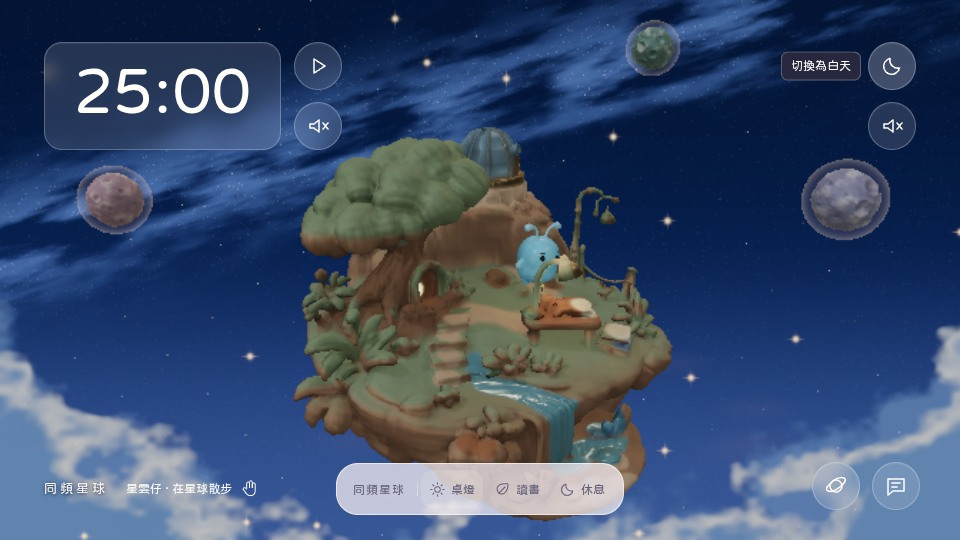

# 同頻星球

同頻星球是一個可以探索的 3D 專注空間。設定星球鐘，讓星雲仔在書桌旁陪你讀書。休息時可以切換星球、聽音樂，或和星雲仔聊幾句。

**[開啟同頻星球](https://companion-planet.onrender.com)**



## 體驗方式

| 功能 | 操作 |
| --- | --- |
| 探索四座星球 | 拖曳旋轉視角，以滾輪或雙指縮放。點選外圍星球，前往同頻星球、月光書原、玫瑰花園或微風森林。 |
| 專注計時 | 在左上角輸入分鐘和秒鐘，再按播放。計時期間可暫停、繼續或重新開始。 |
| 與星雲仔互動 | 點星雲仔看短句和表情，或用右下角的聊天按鈕開啟對話。下方也能請他讀書或休息。 |
| 切換氣氛 | 右上角可切換日夜與環境音。各星球有自己的背景音樂，桌燈可獨立開關。 |

## 作品展示

- [四座星球場景總覽](artifacts/user-worlds/integration/four-worlds.jpg)
- [手機畫面](artifacts/user-worlds/integration/phone-worlds.jpg)
- [星雲仔的 12 種表情](artifacts/nebula-expressions/12-expressions.png)

網站使用 React、TypeScript、Three.js 與 React Three Fiber 即時渲染，並以 Express 提供聊天 API。四座浮島以 GLB 載入，具備各自的材質、地形和配樂。星球旅行與場景互動可在桌面和手機瀏覽器操作。

## 本機執行

需 Node.js 24 與 npm。

```sh
npm ci
npm run dev
```

開啟 `http://localhost:5173`。正式建置可執行 `npm run build`，再用 `npm start` 啟動。

聊天支援相容 OpenAI Chat Completions 的服務。在本機專案的 `.env` 或 Render 的 **Environment** 設定 `LLM_API_KEY`、`LLM_BASE_URL` 和 `LLM_MODEL`。金鑰只由後端讀取。未設定金鑰或模型服務失敗時，聊天會使用本機備援台詞。

## Chrome 右側分割搜尋

桌機 Chrome 156 以上若提供原生分割 API，可透過[同頻星球分割搜尋擴充套件](extensions/search-split)使用。

1. 下載並解壓縮專案，保留 `extensions/search-split` 資料夾。
2. 開啟 `chrome://extensions`，啟用「開發人員模式」，選擇「載入未封裝項目」，指定該資料夾。
3. 重新整理[同頻星球正式網站](https://companion-planet.onrender.com)，開啟搜尋星球並按 Enter 或點放大鏡。

星球會留在左側，Google 結果在右側開啟。再次搜尋會更新同一個右側分頁。擴充套件只接收正式網站主頁面的搜尋請求，直接把搜尋字詞送往 Google。若瀏覽器尚未支援分割 API，或目前視窗已有其他分割組合，仍可用站內的 Google 搜尋連結。
